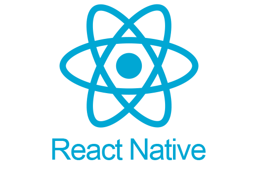

#  안녕하세요, 뉴리뉴리 대표입니다.

사랑하는 얼굴을 귀여운 굿즈로 만드는 핸드메이드 브랜드 **뉴리뉴리(New:ri)** 를 운영하고 있어요. 
앱개발자로 일해 온 경험을 살려, 주문·시안·운영에 필요한 도구도 직접 만들고 있습니다.

 

## 🧸 뉴리뉴리 (New:ri)

> **오직, 당신만을 위한 핸드메이드**

반려동물·가족·연인을 테마로, 고객이 보내 준 소중한 사진을 바탕으로 
쿠션 키링·파우치·지갑 같은 맞춤 굿즈를 하나하나 제작합니다.

**대표 상품**
- 동물 인형키링 (사진 얼굴 주문제작)
- 포토 인형쿠션 · 손쿠션
- 포토 카드지갑 · 포토 파우치
- 쿠션키링 (미니 · 사각)
- 반려동물 이름표(조약돌 인식표) · 털 보관 키링

**뉴리뉴리의 약속**
- 사진 그대로 선명한 인쇄
- 고밀도 방울솜으로 채운 포근한 쿠션감
- 깔끔한 외곽선과 변형 적은 패브릭 원단
- 라벨 각인 · 선물 패키지 구성

**만나는 곳** — 네이버 스마트스토어 · 에이블리 · 쿠팡 · 지그재그 · 텐바이텐

  &nbsp;
  &nbsp;
  &nbsp;
  

 

##  개발자로서

- 현업에서 플러터로 앱을 개발해 왔고, 리액트·리액트 네이티브·Android·iOS 모두 다룹니다.
- 지금은 뉴리뉴리에 필요한 도구를 직접 만들어요 — 고객이 직접 꾸미는 **키링 시안 앱**, 머그컵 3D 시안, 주문 관리 대시보드 등.
- 개발 기술 [블로그](https://velog.io/@unknown420/)를 운영하고, 라이브러리를 만들어 공개합니다. ([EasyPermission-AOS](https://github.com/kmwdevelop/easy-permission-aos))

**Tech**

      
       

 

<b>참여한 프로젝트 보기</b>

 

| 기간 | 프로젝트명 | 사용 플랫폼 | 설명 |
| :---: | ---- | :--: | :-- |
| 24.6 ~ 24.7 | [bluetooth-sdk-aos](https://github.com/hconnectdx/bluetooth-sdk-android) |   | Bluetooth SDK for Android |
| 24.1 ~ 24.4 | HealthLib |    &nbsp; | 헬스커넥트, 애플헬스 Flutter 라이브러리 |
| 24.3 ~ 24.6 | [건강관리 앱](https://github.com/kmwdevelop/-/blob/main/%EC%9D%B8%EB%B0%94%EC%9D%B4%EC%B8%A0/Readme.md) |  | 헬스커넥트, 애플헬스 라이브러리를 활용한 건강관리 앱 |
| 23.4 ~ 24.6 | 헬스밴드 연동 앱 |  | 블루투스 헬스 밴드 연동 앱 |
| 22.1 ~ 24.4 | 보이스캐디 Y1 |   | 골프 개인 수첩 앱 |
| 21.5 ~ 21.10 | [캐디노트 태블릿 앱](https://github.com/kmwdevelop/-/blob/main/%E1%84%8F%E1%85%A2%E1%84%83%E1%85%B5%E1%84%82%E1%85%A9%E1%84%90%E1%85%B3/%5B%E1%84%91%E1%85%B3%E1%84%85%E1%85%A9%E1%84%8C%E1%85%A6%E1%86%A8%E1%84%90%E1%85%B3%5D%20%E1%84%90%E1%85%A2%E1%84%87%E1%85%B3%E1%86%AF%E1%84%85%E1%85%B5%E1%86%BA%20%E1%84%8F%E1%85%A2%E1%84%83%E1%85%B5%E1%84%82%E1%85%A9%E1%84%90%E1%85%B3%20-%20%E1%84%89%E1%85%A1%E1%86%B7%E1%84%89%E1%85%A5%E1%86%BC%20%E1%84%80%E1%85%A9%E1%86%AF%E1%84%91%E1%85%B3%208821e74eb52243ee992b406b4edb7c85.md) |  | 골프 캐디용 스코어 기록 태블릿 앱|
| 19.1 ~ 20.1 | DLL, jar 통신라이브러리 |    | 전자저울과 통신할 수 있는 C++, C#, Java용 통신모듈|
| 19.1 ~ 20.1 | 전자저울 연동 윈도우 프로그램 |  | 전자저울을 연동하여 데이터를 관리할 수 있는 윈도우 프로그램|

#### 사이드 프로젝트

| 기간 | 프로젝트명 | 사용 플랫폼 | 설명 |
| :------: | ---- | :----: | :-- |
| 24.9 ~ 24.12 | [내집플랜](https://github.com/kmwdevelop/-/tree/main/MyZipplan) |  | 전월세 대출 추천 서비스 |
| 24.7 ~ 24.7 | [EasyPermission-AOS](https://github.com/kmwdevelop/easy-permission-aos) |    | 퍼미션 작업 매번 하기 귀찮아서 만든 AOS 라이브러리 |
| 24.6 ~ 24.7 | [팝핀](https://github.com/kmwdevelop/-/blob/main/%E1%84%91%E1%85%A1%E1%86%B8%E1%84%91%E1%85%B5%E1%86%AB/readme_poppin.md) |  | 팝업스토어의 소식을 알림 받고, 정보를 제공받는 서비스 |
| 20.1 ~ 20.2 | 한동은 목사의 아침묵상 | &nbsp; | 녹음된 설교 말씀을 다운받고 관리할 수 있는 서비스 |

